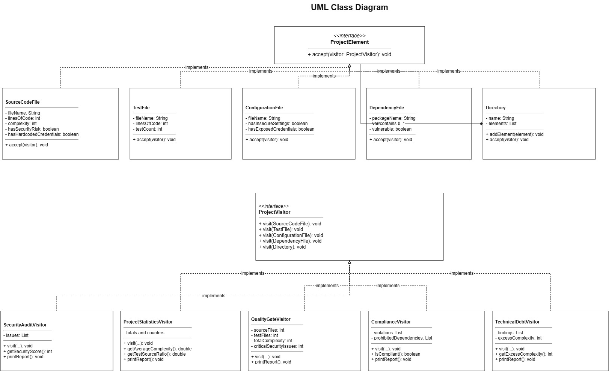
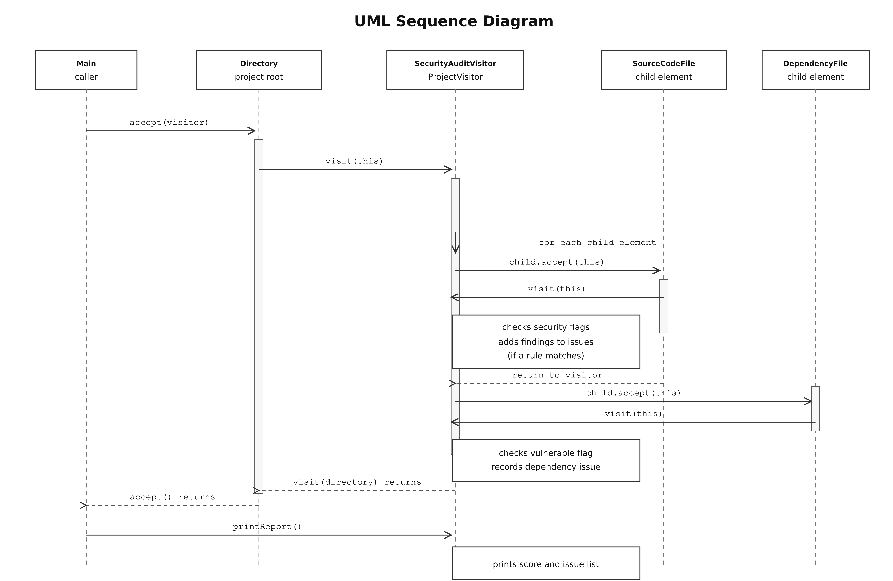

## Architecture Description

The project uses the Visitor Pattern to keep project elements separate from operations performed on them.

`ProjectElement` defines the `accept(ProjectVisitor visitor)` method. `SourceCodeFile`, `TestFile`, `ConfigurationFile`, `DependencyFile`, and `Directory` implement this interface. A `Directory` can contain files and nested directories.

`ProjectVisitor` declares a `visit(...)` method for each element type. The concrete visitors implement different operations:

`SecurityAuditVisitor` checks for security risks and produces a security report.

`ProjectStatisticsVisitor` calculates project metrics.

`QualityGateVisitor` decides whether the project meets release criteria.

`ComplianceVisitor` checks project rules.

`TechnicalDebtVisitor` reports source files whose complexity exceeds the configured limit.

## Example Console Output

```
Security score: 100/100
No security issues found.
Total files: 6
Lines of code: 60
Number of test: 4
Dependencies: 1
Average complexity: 6.0
Test/source ratio: 0.5
Security: PASS
Complexity: PASS
Tests: PASS
FINAL RESULT: PASSED
Compliance: PASS
Technical debt report:
No source files exceed complexity 10.
Total excess complexity: 0
```

## Visitor Limitation Challenge

If we add a new element called `DatabaseMigrationFile`, we must add it to the element hierarchy and update the `ProjectVisitor` interface with a new method:

`void visit(DatabaseMigrationFile file);`

`DatabaseMigrationFile` must implement `ProjectElement` and define `accept(ProjectVisitor visitor)` by calling `visitor.visit(this)`.

Every concrete Visitor must then implement `visit(DatabaseMigrationFile file)`, for example `SecurityAuditVisitor`, `ProjectStatisticsVisitor`, `QualityGateVisitor`, `ComplianceVisitor`, and `TechnicalDebtVisitor`.

This shows the limitation of the Visitor Pattern: adding a new operation is easy because we create another Visitor, but adding a new element requires changes to the visitor interface and all concrete Visitors.

## Questions

### 1. What problem does Visitor solve?

The project contains different element types, such as source files, test files, configuration files, dependencies, and directories. Each type needs several operations, including security auditing, statistics, quality checks, compliance checks, and technical debt analysis.

The Visitor Pattern keeps these operations in separate visitor classes instead of placing every operation inside each element class.

### 2. Where are Element and Visitor?

`ProjectElement` is the element interface. `SourceCodeFile`, `TestFile`, `ConfigurationFile`, `DependencyFile`, and `Directory` are concrete elements. They are located in `src/fintech/`.

`ProjectVisitor` is the visitor interface. `SecurityAuditVisitor`, `ProjectStatisticsVisitor`, `QualityGateVisitor`, `ComplianceVisitor`, and `TechnicalDebtVisitor` are concrete visitors. They are also located in `src/fintech/`.

Each element implements `accept(ProjectVisitor visitor)`. Each concrete visitor implements the `visit(...)` methods declared in `ProjectVisitor`.

### 3. What is double dispatch?

Double dispatch means that the operation depends on both the concrete element type and the concrete visitor type.

First, `element.accept(visitor)` calls the element's implementation of `accept`. That method then calls `visitor.visit(this)`. For example, `SourceCodeFile.accept()` calls `visit(SourceCodeFile)`, and the selected visitor performs its operation on that source file.

### 4. Why not put all operations inside the Element classes?

That would mix project data with many separate responsibilities. Each new operation would require changes to several element classes, making them larger and harder to maintain. Visitors keep those operations separate.

### 5. Is it easier to add a new Visitor or a new Element?

It is easier to add a new Visitor. A new operation can be implemented in a new visitor without changing the existing element classes.

Adding a new element is harder because `ProjectVisitor` must gain a new `visit(...)` method, and every concrete visitor must implement it.

### 6. When would Visitor be a bad choice?

Visitor may be a poor choice when the element types change frequently, when the object structure is small and simple, or when adding a new element would require updating many visitors.

### 7. How is Visitor different from Strategy?

Visitor adds different operations over a set of element types. It selects an operation based on the concrete element type through `accept()` and the matching `visit(...)` method.

Strategy provides interchangeable algorithms for one task. The caller chooses a strategy, and the object delegates that task to it. Strategy does not normally require a separate operation for every concrete element type.

### 8. Which SOLID principles can be identified?

**Single Responsibility Principle:** Element classes store project data, while visitor classes perform separate operations.

**Open/Closed Principle:** New operations can be added as new visitors without modifying existing element classes.

**Dependency Inversion Principle:** Elements depend on the `ProjectVisitor` interface rather than on concrete visitor classes.


## UML Diagrams

**Class Diagram**


**Sequence Diagram**



## Test Results
The project contains at least 12 meaningful JUnit 5 tests. They cover the service classes, different project element types, all visitor behaviors, nested and empty directories, Quality Gate pass and fail scenarios, compliance violations, and edge cases.

All tests passed.
